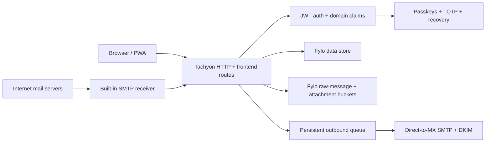

<p align="center">
  <strong style="font-size: 2em;">CADUCEUS</strong><br/>
  <em>Open-source multi-domain mail server and webmail for teams.</em>
</p>

<p align="center">
  <a href="https://github.com/d31ma/caduceus/releases/latest"></a>
  <a href="https://github.com/d31ma/caduceus/actions/workflows/ci.yml"></a>
  <a href="https://github.com/d31ma/caduceus/pkgs/container/caduceus"></a>
  <a href="https://go.dev"></a>
  <a href="https://bun.sh"></a>
</p>

<p align="center">
  <strong>Own your mail domain. Run the complete mail stack yourself.</strong><br/>
  Built with <code>Tachyon</code> routes, a polished browser mail client, and <code>Fylo</code> local persistence.
</p>

---

## Table of Contents

- [Why CADUCEUS?](#why-caduceus)
- [Quick Start](#quick-start)
- [Features](#features)
- [Architecture](#architecture)
- [Docker](#docker)
- [Admin Bootstrap](#admin-bootstrap)
- [Inbound Mail](#inbound-mail)
- [Attachments](#attachments)
- [Push Notifications](#push-notifications)
- [Domain Migration](#domain-migration)
- [Testing](#testing)
- [Configuration](#configuration)
- [Image Hardening](#image-hardening)
- [Extending the Image](#extending-the-image)

---

## Why CADUCEUS?

CADUCEUS is a self-hostable mail server and webmail experience for teams that want a small, auditable mail system instead of a hosted black box.

| Capability | CADUCEUS |
|---|---|
| Multi-domain mailboxes | Domain-scoped users, routes, and admin claims |
| Browser mail client | Inbox, search, folders, compose, scheduled mail, settings |
| Local persistence | Fylo document metadata with raw-message and attachment buckets |
| Standalone mail server | Built-in inbound SMTP, direct-MX/DKIM delivery, and ACME certificates |
| Authentication | Passkeys, optional password + passkey, TOTP, and recovery codes |
| Deployment | Single Docker image for a VM or bare-metal host with port 25 access |
| PWA support | Installable desktop/mobile web app with push notification support |

---

## Quick Start

Install every independently released binary at the versions pinned in
`runtime.lock.json`, then install the JavaScript dependencies:

```sh
curl -fsSL https://github.com/d31ma/Tachyon/releases/download/v26.33.02/install.sh | sudo sh
curl -fsSL https://github.com/d31ma/Fylo/releases/download/v26.33.02/install.sh | sudo sh
curl -fsSL https://github.com/d31ma/Chex/releases/download/v26.32.02/install.sh | sudo sh
curl -fsSL https://github.com/d31ma/TTID/releases/download/v26.32.03/install.sh | sudo sh
# SESAME has no installer script. Download the v26.33.02 artifact for your
# platform and verify it against that release's SHA256SUMS before installation.
bun install --frozen-lockfile
bun run test
```

The exact FYLO and SESAME releases are qualified together for the mail and
identity stores. Tachyon `26.33.02` supplies the client-rendered structural
model required by the web application. Before attempting a production rollout,
review the complete support boundaries in
[`docs/COMPATIBILITY.md`](./docs/COMPATIBILITY.md).

Build the Go binary, then start everything with its entry point. `caduceus
entry serve` starts the Go FYLO owner, creates the collections, hands the
settings to the Go server as `YON_*` in `.env`, runs `ty serve` (the Go server
in `server/` and the browser client on one origin), and supervises the inbound
MX, submission, ACME and the queue workers:

```sh
bun run go:build
FYLO_ROOT=.data \
FYLO_BINARY="$(command -v fylo)" \
SESAME_BINARY="$(command -v sesame)" \
SESAME_DEPLOYMENT=.sesame \
INBOUND_WEBHOOK_SECRET=dev-inbound-secret \
EXTERNAL_ACCOUNT_CREDENTIAL_KEYS='{"1":"<32 random bytes, base64url>"}' \
EXTERNAL_ACCOUNT_ACTIVE_KEY=1 \
dist-bin/caduceus entry serve
```

`bun run start` does the same. The entry point passes `PORT` (default 8080) to
`ty serve` as `--port`, and a non-loopback `HOST` as `--host` with
`--allow-non-loopback`.

Create the first admin user (the entry point starts the FYLO owner for the
operator script):

```sh
dist-bin/caduceus entry admin:create \
  --email=admin@example.com \
  --domain=example.com
```

Build the static frontend and compile the Go handlers:

```sh
bun run bundle
```

The frontend build is written to `dist/web/`.

### Go binary

`dist-bin/caduceus` is the whole runtime: `entry` (the container entry point),
`fylo-bridge` (the FYLO owner), `inbound-smtp` (the inbound MX alone), `auth`
(SESAME deployment and provisioning), `backup`, `attachments`, `migrate` and
`doctor`. The Go server in `server/` is compiled by Tachyon; see
[`docs/GO_PORT.md`](./docs/GO_PORT.md).

---

## Features

### Mailbox

- Server-side search through `GET /inbox`.
- Search operators: `from:`, `to:`, `subject:`, `body:`, `filename:`, `has:attachment`, `is:read`, `is:unread`, and `is:starred`.
- Folders such as `inbox`, `archive`, `trash`, `snoozed`, and custom route targets.
- Read/unread, starred, drag-and-drop folder moves, and permanent delete.
- MIME attachment parsing and metadata display.

### Browser App

- Tachyon-powered HTML/CSS/JS UI.
- Desktop sidebar with mailbox sections and folder navigation.
- Mobile PWA shell with a responsive navigation drawer, safe-area handling,
  and a configurable all-hosted-domains or focused-domain app-icon unread
  badge with a live tab-title fallback.
- Theme switching across light, dark, and auto modes.
- Exact GitHub notification messages expose a validated View on GitHub action
  and `mod+g` shortcut; sender and target lookalikes fail closed.
- Complete conversation reading provides collapsible messages and quotations,
  per-message Reply/Reply All/Forward/Open/`.eml` actions, and bounded
  find-in-conversation traversal from the keyboard or accessible controls.
- Compose flow with searchable rich templates, keyboard-navigable editable
  blanks, draft-to-template creation, per-primary-or-alias rich signatures,
  exact From selection, template/signature management, send later, read
  receipts, and link tracking controls.
- Self-hosted delivery insights with opt-in per-recipient open/link tracking,
  a mailbox-owned Activity feed, and bounded daily and subject analytics.

### Self-hosted delivery

- Built-in SMTP receiver for hosted domains.
- Direct-to-MX outbound SMTP with DKIM signing and retry/bounce queues.
- Authenticated SMTP submission for desktop and mobile mail clients.
- Provider-free passkey and TOTP authentication with one-time recovery codes.

---

## Architecture

The repository follows the Tachyon workspace layout, with the server in Go:

```text
client/                 # the browser client (Tachyon Tac)
server/                 # the Go server, compiled by Tachyon Yon
  controllers/ services/ helpers/ models/
  shared/<area>/        # route logic, records, protocols (plain Go)
cmd/caduceus/           # the Go binary: entry point, FYLO owner, mail services
internal/               # its packages: runtime/entry, mail/{inbound,submission,smtpd}, platform/...
db/schemas/             # FYLO schemas
tests/support/legacy-server/  # the former JavaScript server: reference and test seeding only
```



The app stores mail metadata as Fylo documents and raw messages and attachment
bytes in Fylo buckets. Email enters and leaves through the built-in SMTP
services, while authentication remains local to the deployment.

---

## Docker

Published images are available at [`ghcr.io/d31ma/caduceus`](https://ghcr.io/d31ma/caduceus).

```sh
docker run --rm \
  --cap-add CHOWN \
  -p 8080:8080 \
  -e INBOUND_WEBHOOK_SECRET=change-me-too \
  -e EXTERNAL_ACCOUNT_CREDENTIAL_KEYS='{"1":"<32 random bytes, base64url>"}' \
  -e EXTERNAL_ACCOUNT_ACTIVE_KEY=1 \
  -e WEB_PUSH_DISABLED=true \
  -e FYLO_ROOT=/data/caduceus \
  -v caduceus-data:/data \
  ghcr.io/d31ma/caduceus:latest
```

Build locally:

```sh
docker build -t caduceus:local .
```

The Go server needs Tachyon features newer than the pinned release. Until one
ships, build with an unreleased Linux `ty`:

```sh
docker build --build-context tachyon-override=<dir holding ty> -t caduceus:local .
```

The image's entry point is `caduceus entry`; the build compiles the Go handlers
with `ty bundle`, so the image serves without a compiler.

The container serves the API on `PORT` and stores data under `FYLO_ROOT`.

Allowed entrypoint commands:

- `serve`: start CADUCEUS
- `admin:create`: create the first admin for a domain
- `domain:migrate`: promote users from one domain suffix to another

Any other command is rejected by the default entrypoint unless the operator deliberately overrides it.

---

## Admin Bootstrap

Create the first admin from a trusted shell with access to the same Fylo data directory used by the server:

```sh
FYLO_ROOT=.data \
bun run admin:create \
  --email=admin@example.com \
  --domain=example.com
```

With Docker:

```sh
docker run --rm \
  -v caduceus-data:/data \
  ghcr.io/d31ma/caduceus:latest \
  admin:create \
    --email=admin@example.com \
    --domain=example.com
```

The command creates the domain with a default `*@domain` store route if needed, creates an admin user scoped to that domain, and prints a one-time enrollment code. Sign in with that code, create a password, register a passkey, and generate recovery codes immediately.

---

## Inbound Mail

The canonical inbound contract is `POST /inbound/webhook`.

Requests must send JSON and include `X-Caduceus-Signature`, an HMAC-SHA256 signature over the exact JSON body using `INBOUND_WEBHOOK_SECRET`.

```json
{
  "recipient": "alice@example.com",
  "sender": "sender@other.com",
  "subject": "Hello",
  "body": "Raw message body or MIME source",
  "messageId": "optional-source-id"
}
```

The webhook is an internal bridge used by the built-in SMTP receiver and the local outbound worker; it is not a cloud-provider integration point.

Mailbox owners can build ordered incoming-mail rules in Settings for their
primary address or exact aliases. Rules support From, To, CC, Subject, Body,
and attachment predicates; folder, forward, delete, read/unread, and star
actions; stop-processing semantics; and a side-effect-free dry-run preview.

## Standalone mail server

CADUCEUS runs as a **true MTA** — receiving mail directly over SMTP and sending
it straight to each recipient's MX. Set `MAIL_SERVER_ENABLED=true` and configure
the standalone mail-server block in `.env.example`.

- **Receiving** — a built-in SMTP server (`internal/mail/inbound`, run by `caduceus entry`)
  listens on port 25, accepts mail for your hosted domains, and hands each
  message to the same `/inbound/webhook` pipeline (storage, spam, routing,
  rules, push). Each message is checked for
  **SPF/DKIM/DMARC** (via `mailauth`): the result is recorded in an
  `Authentication-Results` header, and a DMARC failure (an authenticated spoof)
  is routed to spam. Disable with `MAIL_AUTH_VERIFY=off`.
- **Sending** — the `direct` outbound adapter (`SmtpDirectAdapter`) resolves each
  recipient domain's MX itself, connects on port 25 with opportunistic STARTTLS,
  and DKIM-signs the message (`DKIM_*`). Set `SMTP_TLS_POLICY=require` only for
  destinations where absent or invalid STARTTLS must fail closed.
- **Delivery queue** — outbound mail flows through a persistent `outbox` queue
  (`OutboundQueueService`): transient failures retry with exponential backoff,
  and permanent failures (or exhausted retries) bounce a delivery-failure notice
  into the sender's mailbox. A supervised, non-overlapping worker drives it
  through the signed local API and records run/failure/duration measurements.
  Partial delivery retains only unconfirmed recipients; an address already
  accepted by an MX is never retried. See the
  [outbound queue runbook](./docs/operations/OUTBOUND_QUEUE.md).
- **Submission** — with `MAIL_SUBMISSION_ENABLED=true`, authenticated SMTP
  submission runs on 587 (STARTTLS) / 465 (implicit TLS) so standard clients
  (Thunderbird, Apple Mail) can send through CADUCEUS using their email +
  password; the message goes through the same `/send` pipeline as the webmail.
- **TLS certificates** — set `MAIL_ACME_ENABLED=true` + `MAIL_ACME_EMAIL` and
  CADUCEUS provisions and auto-renews a Let's Encrypt certificate for
  `MAIL_HOSTNAME` itself (HTTP-01 challenge on port 80; SMTP servers hot-reload
  the renewed cert via SNI, no restart). Or bring your own PEM with
  `MAIL_TLS_CERT_FILE` / `MAIL_TLS_KEY_FILE`.

Enabled SMTP listeners and the outbound queue worker are required runtime
components. A startup or listener failure stops the application so Docker or
the host service manager can restart it. ACME renewal is intentionally
degradable: a provisioning failure is reported without hiding an otherwise
usable server. Shutdown closes background resources in reverse startup order.

Runtime state is written as secret-free JSON records prefixed with
`[mail:status]`. The record includes component state and outbound queue run,
success, failure, overlap, duration, depth, due count, oldest age, attempts,
and last delivery/retry/bounce measurements. Set
`MAIL_STATUS_INTERVAL_MS` to change the five-minute reporting interval, or `0`
to retain only startup and shutdown records.

### Test it locally on port 25 (Docker)

`docker-compose.yml` runs the whole standalone server against the seeded `db/`
data — no external service, no DNS. The container runs as non-root and can't bind
privileged ports, so the inbound MX listens on 2525 inside and the host maps
`25 → 2525`.

```sh
docker compose up --build
# in another shell — send a real SMTP message to the MX on port 25:
bun scripts/send-test-mail.mjs admin@caduceus.com localhost 25
```

Then open the webmail at <http://localhost:8080> and the message appears in
`admin@caduceus.com`'s inbox. New mail persists back to `./db` on the host (the
production image never copies `db/`). Outbound is `console` (logs only) in the
development Compose file; production defaults to direct-MX delivery.

Because email is built on DNS, a standalone deployment still needs, at any DNS
provider (not a specific one):

- `MX` → `mail.your-domain.com`, and an `A/AAAA` for that host
- `SPF`, `DKIM` (publish the public key at `<selector>._domainkey.<domain>`), and `DMARC` TXT records
- a matching **PTR / reverse-DNS** on the server IP (set by your IP host)
- a host that permits inbound **and** outbound TCP **port 25** (most clouds block outbound 25 by default), plus inbound TCP **80** if you use automatic ACME certs

Deliverability (IP reputation, blocklists, warm-up) is the real operational work;
receiving is straightforward, getting the world to trust your sending IP is not.

Run the image on a VM or bare-metal host with a static IP, working reverse DNS,
and unrestricted inbound/outbound TCP port 25. Serverless platforms and hosts
that block port 25 are not supported deployment targets.

---

## Attachments

Inbound MIME attachments are parsed from raw message bodies.

- Metadata is stored in Fylo.
- Raw bytes are stored in Fylo's `attachment-files` bucket with content hashes,
  MIME metadata, logical object keys, and normal Fylo soft-delete behavior.
- The bucket is part of `FYLO_ROOT`; no separate attachment path or service is
  required. Existing path-backed records remain readable during migration.
- Existing deployments that used a custom `ATTACHMENT_ROOT` should retain that
  environment variable until their legacy attachments have been retired.
- The authenticated reader resolves inline `cid:` references only for inert
  raster image types, and offers sandboxed image, text, and PDF previews.
  SVG and unknown formats remain download-only. Untrusted MIME filenames are
  normalized before storage and download.
- Consented remote images are fetched through an exact-message, rate-limited,
  DNS-pinned proxy and enter the sandbox only as inert raster data. The browser
  never contacts the sender's image host. Disguised and internationalized links
  show their actual destination before the user can open them.
- The composer accepts attachments from its picker, clipboard paste, or
  drag/drop with one shared limit: 10 files, 10 MiB each, and 25 MiB total.

---

## Push Notifications

CADUCEUS can notify installed desktop and mobile PWA users when new mail arrives.
Each notification carries the authoritative unread inbox count using the
user's persisted preference: all hosted domains or one focused domain.
Supporting platforms update the installed-app icon via the Badging API; other
browsers prefix the tab title with the same count. The count is reconciled
whenever mailbox state changes and is cleared on sign-out.
Clicking a background notification focuses an existing CADUCEUS window or
opens the message deep link.

Generate VAPID keys:

```sh
bun node_modules/.bin/web-push generate-vapid-keys
```

Set:

- `VAPID_PUBLIC_KEY`
- `VAPID_PRIVATE_KEY`
- `VAPID_SUBJECT`, for example `mailto:admin@example.com`

Local development can fall back to an in-memory VAPID keypair. Production requires stable VAPID keys unless `WEB_PUSH_DISABLED=true`.

---

## Domain Migration

Use `domain:migrate` when a mailbox domain is changing but users should keep the same local part and mailbox history.

Dry run:

```sh
FYLO_ROOT=.data bun run domain:migrate --from=old.example --to=new.example
```

Apply:

```sh
FYLO_ROOT=.data bun run domain:migrate --from=old.example --to=new.example --apply
```

With Docker:

```sh
docker run --rm \
  -v caduceus-data:/data \
  ghcr.io/d31ma/caduceus:latest \
  domain:migrate --from=old.example --to=new.example --apply
```

The command clones domain config when needed, copies inbox rules, promotes users to the new suffix, records the old address as an alias, and keeps historical email records audit-friendly.

---

## Testing

Run core tests:

```sh
bun run test
```

Run browser E2E tests:

```sh
bun run test:e2e
```

Run the complete frozen Phase 0 baseline, including interaction and responsive
visual regression coverage:

```sh
bun run verify:phase0:all
```

Run the complete Phase 1 Go qualification:

```sh
bun run verify:phase1
```

This rebuilds and manifests the Tachyon frontend, then runs Go formatting,
unit and black-box tests, vet, the race detector, the 80% coverage ratchet, the
CRAP 15 ceiling, and an injected build-metadata check.

Run both completed phase gates:

```sh
bun run verify:phase1:all
```

The browser half requires the Playwright Chrome runtime:

```sh
bun node_modules/.bin/playwright install chrome
```

---

## Configuration

### Core

| Variable | Description |
|---|---|
| `HOST` | Bind address; Go defaults to `127.0.0.1`, the legacy Docker runtime explicitly uses `0.0.0.0` |
| `PORT` | HTTP port, default `8080` in Docker |
| `METRICS_HOST` / `METRICS_PORT` | Go operations listener, fixed to loopback and defaulting to `127.0.0.1:9090` |
| `STATIC_DIR` | Manifested Go-served frontend directory, default `build/static` |
| `RUNTIME_LOCK` | Runtime artifact lock, default `runtime.lock.json` |
| `SHUTDOWN_TIMEOUT` | Go HTTP drain bound, default `10s` |
| `FYLO_ROOT` | Fylo data directory; its parent must be writable for the exclusive lease (`/data/caduceus` in Docker) |
| `FYLO_SCHEMA` | Fylo schema directory, default `db/schemas` |
| `FYLO_INDEX_BACKEND` | Fylo index backend, default `local-fs` |
| `FYLO_BINARY` | Required by the Go runtime; optional override for the legacy adapter |
| `FYLO_POSIX_ACCESS` | Set to `true` to enforce issue-68 UID/GID access through the Fylo machine protocol |
| `FYLO_BRIDGE_ADDRESS` | Private Go-to-legacy persistence bridge; explicit loopback only, default `127.0.0.1:9876` |
| `FYLO_BRIDGE_SECRET` | HMAC key for separately launched hybrid processes; the container generates an ephemeral 32-byte key |
| `FYLO_INCOMING_ROOT` | Only directory from which the bridge accepts raw attachment files |
| `FYLO_REQUEST_TIMEOUT` | Per-operation FYLO deadline, default `10s` |
| `FYLO_MAX_REQUEST_BYTES` / `FYLO_MAX_RESPONSE_BYTES` | Negotiated machine frame limits, defaults `1 MiB` / `8 MiB` |
| `FYLO_MAX_ATTACHMENT_BYTES` | Single raw attachment limit, default `50 MiB` |
| `FYLO_ATTACHMENT_QUOTA_BYTES` | Total attachment bucket limit, default `10 GiB` |
| `MICROSOFT_OAUTH_CLIENT_ID` / `MICROSOFT_OAUTH_CLIENT_SECRET` | Optional atomic Microsoft Entra confidential-app credentials for Microsoft 365 accounts |
| `MICROSOFT_OAUTH_TENANT` | Entra tenant segment, default `organizations` |
| `MICROSOFT_OAUTH_REDIRECT_URI` | Exact registered Settings callback, normally `https://mail.example.com/settings` |
| `GOOGLE_OAUTH_CLIENT_ID` / `GOOGLE_OAUTH_CLIENT_SECRET` | Optional atomic Google web-app credentials for Gmail and Workspace accounts |
| `GOOGLE_OAUTH_REDIRECT_URI` | Exact registered Settings callback, normally `https://mail.example.com/settings` |
| `YON_ROUTES_PATH` | Tachyon route directory, default `server/routes` |
| `YON_PAGES_PATH` | Tachyon page directory, default `client/pages` |
| `YON_COMPONENTS_PATH` | Tachyon component directory, default `client/components` |
| `YON_ASSETS_PATH` | Tachyon asset directory, default `client/shared/assets` |
| `JWT_SECRET` | Required signing key for session tokens |
| `INBOUND_WEBHOOK_SECRET` | HMAC key for signed inbound delivery |
| `TRACKING_SECRET` | Dedicated encryption key for recipient tracking capabilities; use at least 32 random characters |
| `CADUCEUS_PUBLIC_URL` | Canonical credential-free HTTPS origin embedded in delivered tracking resources |
| `WEB_PUSH_DISABLED` | Set to `true` to disable push delivery |

### Push

| Variable | Description |
|---|---|
| `VAPID_PUBLIC_KEY` | Public Web Push key |
| `VAPID_PRIVATE_KEY` | Private Web Push key |
| `VAPID_SUBJECT` | Contact URI for Web Push |

### Delivery

| Variable | Description |
|---|---|
| `SMTP_ADAPTER` | `direct` in production; `console` for development/tests |
| `MAIL_HOSTNAME` | Public SMTP hostname used for banners and EHLO |
| `DKIM_DOMAIN` / `DKIM_SELECTOR` | DKIM signing identity |
| `OUTBOUND_QUEUE_WORKER` | Set to `off` to disable the persistent queue worker |
| `OUTBOUND_QUEUE_INTERVAL_MS` | Queue polling interval, default `30000` |
| `OUTBOUND_QUEUE_TIMEOUT_MS` | Timeout for a local queue pass, default `60000` |
| `SNOOZE_WORKER` | Set to `off` to disable automatic return of due snoozed conversations |
| `SNOOZE_INTERVAL_MS` | Snooze due-record polling interval, default `30000` |
| `SNOOZE_TIMEOUT_MS` | Timeout for one local snooze return pass, default `60000` |
| `REMINDER_WORKER` | Set to `off` to disable automatic no-reply reminder resurfacing |
| `REMINDER_INTERVAL_MS` | Follow-up due-record polling interval, default `30000` |
| `REMINDER_TIMEOUT_MS` | Timeout for one local follow-up pass, default `60000` |
| `MAIL_STATUS_INTERVAL_MS` | Structured status-log interval, default `300000`; `0` disables periodic records |

No cloud email adapters or SMTP relay modes are included.

### FYLO single-writer bridge

FYLO `26.33.02` is the locked production release. The Go process is the only
component that starts it, always with an exclusive-root lease. The legacy
Tachyon routes reach that owner through an authenticated loopback bridge.
Docker creates a fresh bridge secret at every start; a split-process deployment
must provide the same `FYLO_BRIDGE_SECRET` to both processes.

Operator recovery commands are local and do not require object storage:

```bash
caduceus backup create --destination /backups/caduceus-2026-07-26
caduceus backup verify --source /backups/caduceus-2026-07-26
caduceus backup restore \
  --source /backups/caduceus-2026-07-26 \
  --destination /data-restored
caduceus attachments reconcile
caduceus attachments reconcile --apply
```

Stop the service before these operator commands so the CLI can acquire the
exclusive FYLO root. Reconciliation is a dry run unless `--apply` is explicit.
When `FYLO_POSIX_ACCESS=true`, domain-owned records and raw attachments are
assigned the matching numeric GID
with mode `0660`; inbound delivery uses the same domain context. Callers cannot
supply group membership over HTTP.

Fylo's filesystem ownership changes require the CADUCEUS service account to
have only the operating-system capability needed to assign those numeric GIDs
(for example, `CAP_CHOWN` in a Linux container). The supplied Compose topology
adds only that capability; direct `docker run` deployments must include
`--cap-add CHOWN`. Startup and writes fail closed when ownership cannot be
applied.

### Backend runtime strategy

CADUCEUS is migrating to a strict TypeScript Tachyon/Tac frontend and one
long-running Go production backend. Tachyon remains the frontend development
server and build tool; Go will own production HTTP, SMTP, delivery workers,
authentication, authorization, and the single-writer Fylo boundary. See
[`docs/adr/0002-typescript-frontend-go-backend.md`](docs/adr/0002-typescript-frontend-go-backend.md)
and [`docs/PROJECT_PLAN.md`](docs/PROJECT_PLAN.md).

Per-mailbox plugins and declarative themes use an explicitly trusted,
network-disabled sandbox rather than image customization. Package authors and
operators should follow [`docs/EXTENSIONS.md`](docs/EXTENSIONS.md).

---

## Image Hardening

The production image is built on a Bun distroless base. The entry point is the
Go binary; Bun remains only for the `admin:create` and `domain:migrate`
operator scripts.

- No shell, package manager, or coreutils in the runtime image.
- Runs as non-root user `65532:65532`.
- Test-only routes are omitted from the production image.
- Base images are pinned by digest in the Dockerfile.
- Runtime entrypoint accepts only known CADUCEUS commands.

Trade-off: `docker exec -it <container> sh` will not work. For debugging, reproduce locally with a full Bun image or build a sidecar tool image.

---

## Extending the Image

Downstream images can add routes, static assets, or config files:

```dockerfile
FROM ghcr.io/d31ma/caduceus:latest

COPY --chown=65532:65532 my-routes/ /app/routes/custom/
COPY --chown=65532:65532 my-config.json /app/config.json
ENV CUSTOM_FLAG=true
```

Because the base image is distroless, `RUN` commands that require a shell will not work. To add npm dependencies, use a multi-stage build with a full Bun image and copy the resulting `node_modules` into the final image.

Bind mounts also work for ad-hoc additions:

```sh
docker run --rm \
  --cap-add CHOWN \
  -p 8080:8080 \
  -e JWT_SECRET=change-me \
  -e INBOUND_WEBHOOK_SECRET=change-me-too \
  -e WEB_PUSH_DISABLED=true \
  -e FYLO_ROOT=/data/caduceus \
  -v caduceus-data:/data \
  -v "$(pwd)/my-routes:/app/routes/custom:ro" \
  ghcr.io/d31ma/caduceus:latest
```

Bind-mount sources should be readable by uid `65532`.

---

## License

CADUCEUS is released under the [MIT License](LICENSE).
