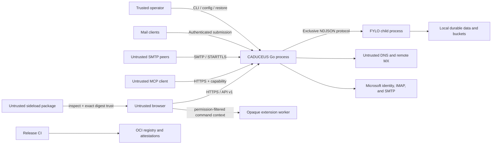

# CADUCEUS Threat Model

Status: Phase 1 runtime foundation  
Review triggers: authentication, SMTP, FYLO protocol, tenant model, network
topology, backup, or release-signing changes.

## Security Objectives

1. A principal can read or mutate only mail and configuration authorized by
   verified domain claims.
2. Accepted mail remains durable, attributable, and recoverable.
3. Outbound mail is neither duplicated nor sent with an unauthorized envelope
   sender.
4. Credentials, recovery material, message contents, and attachment bytes do
   not enter logs or release artifacts.
5. Operators can establish which source, binary, configuration, and migration
   touched data.
6. Compromise of the browser, an SMTP peer, or one tenant does not grant FYLO
   process authority.

## Assets

- message headers, bodies, raw MIME, attachments, calendars, and address books;
- domains, aliases, routing rules, suppression records, and delivery queues;
- password verifiers, passkeys, TOTP secrets, recovery codes, sessions, and the
  security ledger — all held by the SESAME engine, never by CADUCEUS;
- the identity deployment's signing, secrets, and snapshot keys, and the
  per-tenant OIDC client secrets beside them;
- HMAC, DKIM, TLS, VAPID, and ACME secrets;
- FYLO root, schemas, access metadata, backups, and migration checkpoints;
- MCP capability hashes, least-privilege account/folder scopes, and activity
  records;
- encrypted external-provider passwords, Microsoft access/refresh grants, and
  short-lived owner-bound OAuth transactions;
- release images, manifests, SBOMs, provenance, and signing identities.

## Trust Boundaries

The Go process is the policy enforcement point. FYLO virtual uid/gid metadata is
defense in depth, not a substitute for domain authorization.

## Threats and Required Controls

### Cross-tenant access

Threats include forged domain fields, IDOR, alias confusion, batch operations
spanning domains, stale role claims, and hash collisions in virtual identities.

Controls:

- derive scope only from verified claims;
- authorize the fetched resource, not only the requested identifier;
- fail closed before every read, write, bucket read, join, restore, and batch;
- reject mixed-domain batches;
- derive inbox-rule owner and target mailbox from the authenticated primary
  address and exact aliases, return 404 for foreign same-domain rule IDs, and
  require a complete unique owner set for reorder operations;
- use the same side-effect-free evaluator for rule previews and delivery,
  reject direct forward-to-self loops, and never execute preview actions;
- map domain to gid and principal to uid deterministically;
- test owner, same-domain member, outsider, missing metadata, and collision
  handling through the real FYLO process.

### Authentication and recovery

CADUCEUS implements none of this. One Go-owned SESAME engine makes every
credential, session, token, and permission decision; see
`docs/adr/0003-sesame-authentication-boundary.md` and `docs/PHASE3_AUTH.md`.
What follows is therefore split: what the engine defends against, and what
CADUCEUS still has to get right around it.

Threats include credential stuffing, challenge replay, passkey counter replay,
TOTP brute force, recovery-code reuse, session theft, token forgery, token
confusion, algorithm downgrade, and acting on a revoked session.

Controls inside the engine:

- Argon2id password verifiers with a parameter-upgrade path;
- WebAuthn origin, RP ID, challenge, presence, user-verification, and
  sign-counter clone detection;
- TOTP with durable replay prevention, and bounded attempts per transaction;
- single-use recovery codes;
- transaction expiry and atomic consumption;
- revocable sessions that cascade to refresh-token families, with reuse
  detection on rotation;
- default-deny authorization with a stable reason code and policy version;
- a hash-chained security ledger with rebuildable projections.

Controls CADUCEUS owns:

- the engine is qualified at startup against the digest pinned in
  `runtime.lock.json`, the protocol version, the exact operation list, and
  storage readiness — a gap is a startup failure, not a mid-login one;
- the deployment is never created implicitly, so a volume whose keys failed to
  mount cannot silently mint a new signing key and end every session;
- every request is verified twice for two different facts: the signature
  locally, which cannot see revocation, and the grant at the engine, which can;
- an ID token is refused where an access token is required, checked by claim
  set rather than assumed;
- the deployment's policy, not the client, decides which factors are required,
  and a session issued below policy is revoked rather than handed out;
- a credential change requires a freshly satisfied transaction proven against
  the same principal, single use, not a timestamp on an old session;
- the legacy runtime reaches all of this only through composed `auth.*`
  operations over the authenticated loopback bridge; raw engine operations are
  not forwarded, because orchestrating them is the boundary;
- per-account and per-source rate limits at the HTTP edge.

Residual risks:

- an access token remains valid for its five-minute lifetime against any party
  that does not check liveness; CADUCEUS always checks, but an external
  verifier reading `/auth/jwks` may not;
- losing the deployment directory ends every session and invalidates every
  issued token — it is a backup requirement, not a recoverable state;
- SESAME is a developer preview and has not had an independent security review.

No carrier-mediated authentication or recovery path is permitted.

### External provider OAuth and delegated mailboxes

Threats include OAuth state replay, authorization-code interception, callback
mix-up, provider-error leakage, refresh-token theft, cross-owner account
attachment, stale reconnect overwrites, SSRF through provider endpoints, and a
delegate reading or sending as a mailbox they do not control.

Controls:

- confidential authorization-code flow with S256 PKCE, 256-bit state, exact
  redirect matching, a ten-minute expiry, and atomic single use;
- retain only a state digest and encrypted verifier in exact-owner FYLO
  storage; exchange codes and rotate encrypted refresh grants server-side;
- use fixed Microsoft identity, IMAP, and SMTP endpoints, bounded responses,
  TLS verification, redacted stable errors, and no browser-visible tokens;
- bind every transaction to the SESAME tenant and principal and bind reconnect
  to the persisted account identity and exact revision;
- authenticate XOAUTH2 as the target mailbox, require writable INBOX
  selection, and verify the exact SMTP envelope sender with `MAIL FROM` followed
  immediately by `RSET`, without a recipient or message body;
- preserve journal-first, idempotent SMTP submission and fail closed on an
  ambiguous post-DATA result.

### SMTP and message parsing

Threats include relay abuse, spoofing, header injection, malformed MIME,
decompression or multipart bombs, recipient enumeration, STARTTLS downgrade,
backscatter, and parser differentials.

Controls:

- accept recipients only for enabled hosted routes;
- bind submission identity to the envelope sender;
- bound message, header, part, recipient, attachment, and nesting sizes;
- fuzz MIME, address, DNS, DKIM, SPF, and DMARC parsing;
- preserve raw message evidence while rendering sanitized content;
- use opportunistic TLS for MX delivery and mandatory TLS for submission;
- classify retryable and permanent failures without reflecting attacker content.

### Outbound delivery and queue integrity

Threats include duplicate sends after crash, queue starvation, forged worker
ticks, unauthorized sender domains, SSRF through webhooks, and bounce loops.

Controls:

- durable leases, idempotency keys, attempt records, and bounded retries;
- HMAC-authenticated internal ticks;
- sender-domain authorization before enqueue;
- DNS rebinding-resistant webhook validation and private-address rejection;
- loop prevention and bounded failure notices;
- crash injection before and after remote acknowledgement.

### FYLO process and filesystem

Threats include concurrent writers, protocol desynchronization, oversized
frames, symlink traversal, malicious metadata, lock loss, corruption, and
untrusted restore input.

Controls:

- one persistent child with an exclusive-root lease;
- handshake, protocol version, capabilities, target, and digest validation;
- bounded NDJSON frames, strict UTF-8/JSON, timeout, cancellation, and stderr
  draining;
- local filesystem requirement with proven locking and atomic rename;
- safe-path operations, digest-verified buckets, orphan reconciliation, and
  offline restore validation;
- run as a dedicated non-root OS identity.

### Browser and HTTP

Threats include XSS in mail HTML, CSRF, token leakage, open redirects, malicious
attachments, service-worker persistence, and cache confusion.

Controls:

- parse rendered mail in a detached DOM before iframe insertion; remove active
  elements, event handlers, remote stylesheets/fonts, unsafe links, known or
  tiny tracking pixels, and CSS network vectors;
- block ordinary remote images by default with a CSP that cannot fetch them;
  permit one-message, exact-sender, or global consent while keeping spam
  fail-closed and tracking pixels removed; consented images pass through the
  exact-message authenticated proxy and enter the sandbox only as raster data;
- keep the image proxy from becoming an SSRF or open-proxy primitive by
  requiring exact mailbox ownership and source-HTML membership, limiting URLs,
  bytes, redirects, ports, formats, time, and request rate, rejecting any DNS
  answer outside globally routed space, pinning the validated address into the
  socket lookup, and checking both MIME type and file signature;
- isolate mail in an iframe that grants `allow-same-origin` only so Chromium
  can honor explicit image consent, but grants no scripts, forms, popups, or
  navigation and sends no referrer;
- restrictive CSP and security headers;
- bearer tokens kept out of URLs except the bounded SSE compatibility path,
  which must be replaced before support;
- reduce untrusted MIME filenames to portable leaf names before persistence,
  MIME output, and browser download; reject malformed or duplicate outbound
  Content-IDs;
- resolve inline Content-IDs only after exact mailbox authorization and only
  into inert raster data URLs; remove unresolved or ambiguous references, keep
  SVG download-only, and sandbox image, text, and PDF previews;
- derive external message actions server-side from exact sender and anchor
  semantics; allow only credential-free HTTPS on exact hosts, revalidate in
  the browser, open with `noopener,noreferrer`, and test sender and target
  lookalikes;
- outline internationalized and visible-host-mismatch links inside the inert
  message document, intercept them across the iframe realm, and show the actual
  destination in a responsive confirmation dialog before opening;
- derive quoted-content markers only after sanitization, discard any
  sender-authored marker attributes, and render find-in-conversation segments
  through ordinary text interpolation with bounded terms, fields, and result
  counts;
- invoke translation only after explicit user activation or an explicit
  per-language automatic preference, cap input at 20,000 characters, and
  exclude scripts, styles, code, quoted replies, signatures, and template
  variables from translated HTML;
- load the immutable model and matching ONNX/WASM runtime only from an
  authenticated same-origin allowlist, verify every bounded graph chunk, deny
  runtime Hub/CDN access, and reuse one process-wide model instead of creating
  overlapping high-memory sessions;
- keep the bounded 150-message result cache and language preferences on the
  user's device; never persist translations server-side or send message text
  to a hosted translation endpoint;
- keep at most 500 mailbox index entries in the session-bound AES-GCM vault,
  with full message records capped at 8 MiB, automatically mirrored
  attachments capped at 8 MiB each and 32 MiB per idle hydration slice, and no
  bearer or refresh token in IndexedDB;
- destroy the mailbox mirror key and all ciphertext on sign-out or an
  unauthenticated shell boot so a later shared-device user cannot decrypt a
  prior mailbox;
- allowlisted redirects and no credentialed cross-origin wildcard;
- test service-worker updates, logout, and cache partitioning.

### Browser extensions and themes

Threats include a package gaining mailbox authority merely by being selected,
review/install time-of-check/time-of-use changes, cross-owner package access,
arbitrary script or CSS in the application origin, network or storage
exfiltration, over-broad message/draft context, hostile command results,
infinite worker execution, stale runtime code after disable/logout, and remote
theme assets.

Controls:

- treat file selection as inspection only; normalize the closed manifest and
  source shape server-side, return its SHA-256 digest, and require the owner to
  echo that exact digest in a separate installation request;
- install disabled, store the normalized exact mailbox owner, hide source from
  collection responses, and return 404 for every foreign package identifier;
- allow only engine 26 manifests, reverse-domain package identifiers, bounded
  semantic versions/source/contributions, four named permissions, and three
  host-owned command slots;
- execute plugin source only inside a classic Web Worker created by an
  opaque-origin iframe with a restrictive CSP, `sandbox="allow-scripts"`, no
  same-origin authority, referrer, network, forms, navigation, fonts, media,
  frames, objects, or persistent storage;
- authenticate every cross-frame message by its exact `WindowProxy`, package
  identity, unpredictable per-activation nonce, and request identity;
- derive message metadata and draft context from the host slot, filter it by
  declared permission, bound every string and result, and accept only local
  notifications or allowlisted plain-text compose fields;
- terminate commands after two seconds, tear down frames and pending requests
  on reload, disable, removal, or logout, and remount only host-created buttons;
- permit one enabled owner theme and require themes to have empty source, no
  permissions, no contributions, no arbitrary CSS, and only allowlisted local
  hexadecimal color tokens.

Explicit trust is not code review or a signature guarantee. A trusted plugin
can compute over every field the owner grants it, so the permission review is
the residual authority boundary. The runtime deliberately has no general mail
body, network, navigation, filesystem, or arbitrary DOM permission.

### Model Context Protocol

Threats include leaked long-lived capabilities, confused-deputy account
selection, same-domain mailbox access, folder-exclusion bypass through thread
joins or batches, prompt-induced destructive actions, accidental sending,
token disclosure in logs, cross-origin browser calls, and message content in
activity records.

Controls:

- keep MCP disabled by default and require an independently revocable,
  cryptographically random bearer whose plaintext is returned once and whose
  hash is compared in constant time;
- derive the initial FYLO tenant from the bounded signed token shape rather
  than a caller-provided domain, then re-load the exact owner's current scope
  on every request;
- separate read, write, and send authority; default to read-only and reject a
  tool before executing it when the capability level is insufficient;
- enforce exact owner, allowed domain, and physical-folder exclusions beneath
  every query and mutation; exclusion wins for a complete conversation and a
  batch fails closed unless every unique identifier resolves;
- validate destination folders, sender ownership, recipients, attachments,
  suppression state, and scheduled time through the production mail services;
- accept JSON bodies only, cap them at 1 MiB, rate-limit by capability, reject
  a supplied mismatched browser Origin, and return no-store/nosniff responses;
- retain only bounded redacted audit metadata: parameter names are safe-listed,
  while values, addresses, subjects, bodies, attachment bytes, and capabilities
  are never recorded;
- rotate by revoking the previous active capability, provide explicit revoke
  and activity-clear controls, and keep no reusable plaintext in the UI after
  the one-time display is gone.

### Recipient activity and tracking

Threats include exposing mailbox activity to another tenant or mailbox,
guessable tracking identifiers, forged events, arbitrary redirect abuse,
recipient correlation, HTML corruption, unbounded event growth, and treating
proxy or scanner traffic as proof of human engagement.

Controls:

- open and link tracking default off and require an explicit per-message opt-in
  beside a proxy/prefetch privacy disclosure;
- public resources accept only authenticated, encrypted, expiring capabilities
  that bind event type, server-issued message identity, and recipient;
- click capabilities additionally bind the stored link index and exact HTTP or
  HTTPS destination, so modified tokens and arbitrary URLs fail closed;
- recipient HTML is transformed only at the SMTP boundary, outside quoted
  content, while the Sent row, retained RFC source, and raw queue payload remain
  clean;
- activity queries derive exact mailbox and owned-alias scope from verified
  claims rather than caller filters;
- each message retains at most 100 serialized events, and dashboard work is
  bounded to the newest 500 tracked messages and 100 displayed events;
- the UI labels opens and clicks as delivery signals and never represents them
  as conclusive evidence that a person read a message.

Phase 1 narrows the initial Go HTTP surface further:

- startup verifies every static asset against the synchronized frontend
  manifest before opening either listener;
- static paths are manifest-allowlisted, dot paths and path escapes are
  rejected, and symlinks fail preflight;
- health, readiness, and metrics use a separate loopback-only operations
  listener;
- request identifiers are validated or generated at the boundary and response
  security headers are applied consistently;
- readiness becomes false before bounded graceful shutdown begins.

The Go runtime owns the FYLO writer, the identity engine, and the authorization
boundary. It does not yet own the production HTTP listener for mail routes;
that is Phase 7. Until then the legacy runtime serves them and reaches every
decision through the bridge.

### Supply chain and release

Threats include mutable Actions, compromised dependencies, poisoned builders,
tag/image mismatch, secret-bearing artifacts, and rebuilt releases.

Controls:

- pin Actions to full commit SHAs;
- lock dependencies and verify downloaded binary checksums;
- least-privilege job permissions and protected release environments;
- build a candidate once and promote the same digest;
- publish SBOM, provenance, checksums, attestations, and release manifest;
- scan source, dependencies, image, and secrets before promotion.

### Availability and resource exhaustion

Threats include connection floods, slow SMTP clients, huge searches, queue
growth, disk exhaustion, DNS stalls, and backup contention.

Controls:

- connection, command, request, query, and dependency deadlines;
- per-tenant quotas and global disk reserve;
- bounded pagination and streams;
- backpressure and admission control before persistence;
- readiness reflects required dependencies while health remains process-local;
- capacity alerts, queue-age SLOs, and restore-time objectives.

## Abuse Cases Required in Tests

- user from domain A requests a domain B message or attachment;
- admin from domain A creates, migrates, or routes domain B;
- replayed passkey, TOTP, recovery code, refresh token, and worker signature;
- forged, downgraded, claim-tampered, and cross-audience tokens;
- an ID token presented where an access token is required;
- a revoked session and a suspended principal, on the next request;
- SMTP relay attempt and unauthorized submission sender;
- message accepted, process crashes, then restarts before storage acknowledgement;
- duplicate queue attempt after remote acknowledgement;
- malformed MIME and oversized FYLO protocol frames;
- remote HTML image, stylesheet, font, CSS-background, invisible-pixel, and
  known-provider tracker attempts before and after explicit image consent;
- image-proxy credentials, private/reserved IPv4 and IPv6, mixed DNS answers,
  DNS rebinding, redirect rebinding, custom ports, oversized responses, and
  MIME/signature mismatch;
- link-label destination mismatch, Unicode/punycode homographs, and unsafe
  confirmation targets;
- extension digest substitution, foreign-owner package reads, undeclared
  metadata/draft access, oversized results, infinite activation/commands,
  network/storage attempts, executable themes, CSS URL tokens, and stale
  commands after disable, removal, or logout;
- competing FYLO owner and stale lock recovery;
- restore with missing bucket object, wrong digest, or changed ownership;
- production start with test routes, console delivery, weak secrets, or a dirty
  preview FYLO binary.

## Residual Risks

- Email metadata and delivery timing are visible to the host operator.
- After explicit or persisted image consent, a unique image URL can still tell
  its remote operator that CADUCEUS fetched it; the proxy hides the user's
  network address, browser identity, cookies, and referrer, but not the URL or
  request time from that remote operator.
- Direct SMTP inherits global DNS, reputation, and opportunistic-TLS limits.
- A fully compromised CADUCEUS process has the authority of its tenants; OS
  isolation, least privilege, backup separation, and audit evidence limit but
  do not eliminate that risk.
- FYLO access controls remain preview-only until a reproducible released binary
  passes Phase 2 qualification.

## Ownership

Every security-sensitive change updates this model, its abuse-case tests, and
the relevant ADR. Release approval requires a named reviewer to confirm that no
new trust boundary is undocumented.
